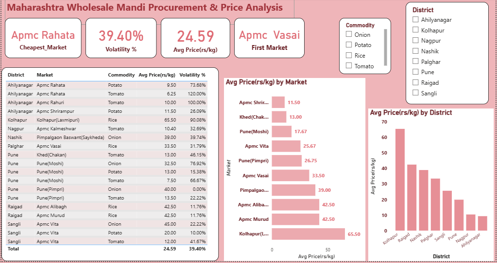

#  Maharashtra Wholesale Mandi Procurement & Price Analysis

An end-to-end data analytics project built using *Python, **MySQL, and **Power BI* to identify cost-saving wholesale agricultural markets (Mandis) and evaluate daily price volatility across Maharashtra.

##  Executive Dashboard Preview

---

##  Business Problem
Retailers, quick-commerce platforms, and food supply chains lose profit margins due to wide regional price gaps and unpredictable daily price swings in wholesale agricultural markets. Using real-world daily market records from *data.gov.in* (Ministry of Agriculture & Farmers Welfare), this project answers:
1. *Which districts and markets offer the lowest average        
     procurement   prices (₹/Kg) for staple crops?*
2. *Which markets carry the highest daily price volatility    
    (Max_Price - Min_Price)?*
3. *How do wholesale rates compare across major Maharashtra hubs 
    (Pune, Nashik, Ahilyanagar, Kolhapur, Nagpur, Raigad)?*

---

##  End-to-End Data Architecture
Raw CSV (data.gov.in) ➔ Python (Cleaning & Feature Engineering) ➔ MySQL (Relational Storage & Views) ➔ Power BI (DAX & Interactive Dashboard)

---

##  Data Cleaning & Feature Engineering (Python)
Real government exports contained raw formatting issues that were resolved programmatically in Mandi_Data_Cleaning.ipynb:
-- *Header Artifact Removal:* Fixed XML space-encoding bugs (Min_x0020_Price ➔ Min_Price).
-- *Date Standardization:* Parsed Indian DD/MM/YYYY strings into ISO YYYY-MM-DD datetime objects.
--*Data Filtering & Integrity:* Filtered for Maharashtra staple commodities (Onion, Tomato, Potato, Rice), stripped trailing whitespace, standardized market casing, and removed zero/invalid price records and duplicates.
--*Feature Engineering:*
  * Price_Per_Kg = Modal_Price / 100 (standardized Quintal rates to consumer-relatable per-kg pricing).
  * Price_Spread = Max_Price - Min_Price (quantified daily market price instability).

---

##  SQL Analysis & Views (MySQL)
Loaded cleaned data into a structured mandi_prices table and created reusable SQL Views (mandi_analysis.sql) for BI reporting:
-- *vw_cheapest_markets:* Aggregates average price/kg, minimum recorded price, and average spread across districts and markets.
-- *vw_daily_trends:* Uses SQL Window Functions (OVER (PARTITION BY ... ROWS BETWEEN 6 PRECEDING AND CURRENT ROW)) to compute 7-day rolling average prices.
-- *vw_price_spikes:* Uses a dynamic subquery (WHERE Price_Spread > (SELECT AVG(Price_Spread) * 1.5 ...)) to flag abnormal price-spike days.

---

##  Power BI & DAX Measures
Connected Power BI directly to MySQL and built custom DAX measures to drive dynamic KPI cards:
dax
Avg Price (₹/Kg) = AVERAGE(mandi_prices[Price_Per_Kg])

Volatility % = DIVIDE(AVERAGE(mandi_prices[Price_Spread]), AVERAGE(mandi_prices[Modal_Price]), 0)

---

##  Key Insights & Business Recommendations
-- *Best Low-Cost Sourcing Hub:* *Ahilyanagar district* (specifically *Rahata APMC* at *₹6.25/Kg* for Tomatoes and *Shrirampur APMC* at *₹11.50/Kg* for Potatoes) offers the lowest wholesale procurement prices across tracked markets.
-- *High Price & Volatility Risk:* *Kolhapur* recorded the highest average price (*₹65.50/Kg) and extreme volatility (90.08%*), indicating a need for forward contracts or buffer inventory.
-- *Predictable Pricing Hub:* *Pune (Pimpri)* maintained *0.00% daily spread* on Onions (*₹40.00/Kg*), making it ideal for stable, fixed-budget daily procurement.

---

##  Repository Structure
* Mandi_Data_Cleaning.ipynb — Python (pandas, numpy) data cleaning and feature engineering notebook

* mandi_analysis.sql — MySQL database schema, data checks, and analytical views

* clean_mandi_maharashtra.csv — Cleaned dataset ready for SQL/BI ingestion

* Mandi_Procurement_Dashboard.pbix — Interactive Power BI Desktop report

* dashboard_preview.png — High-resolution dashboard screenshot

-